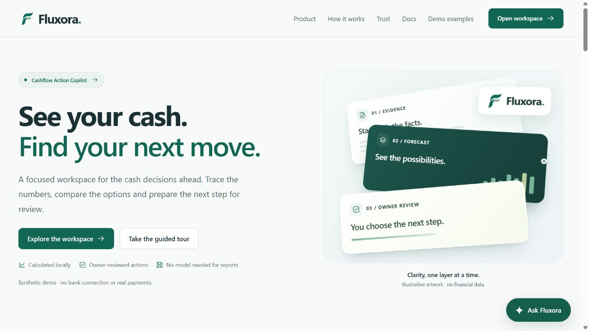
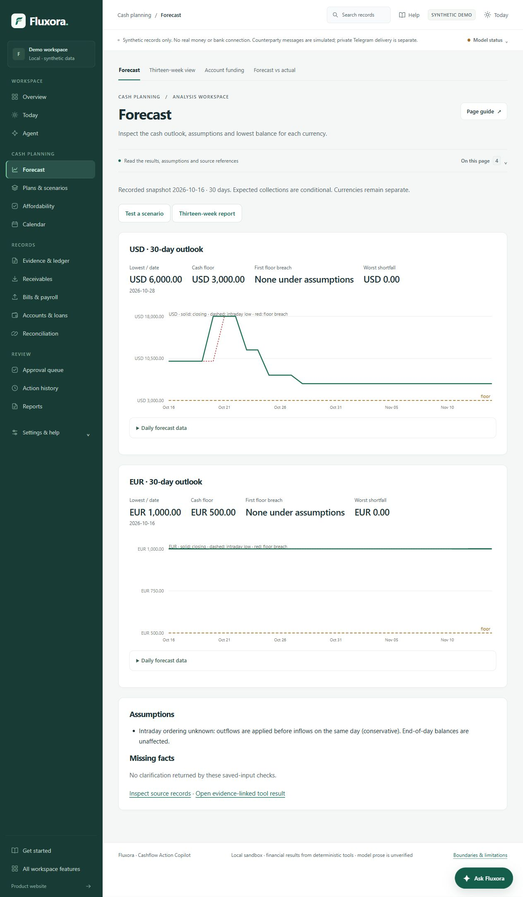
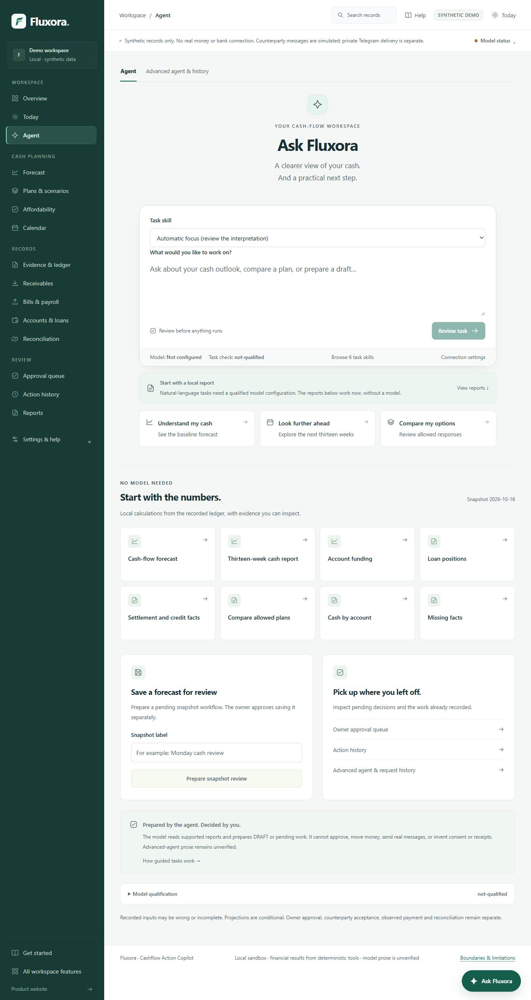
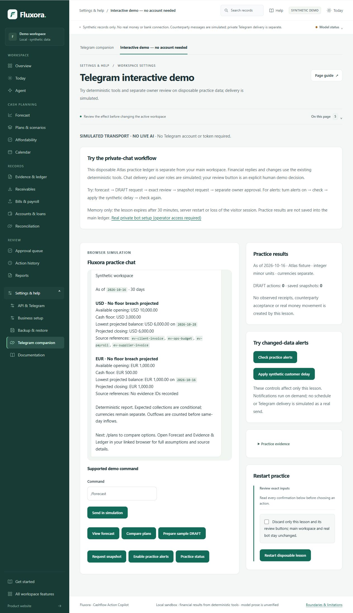
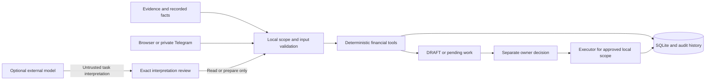

<p align="center">
  
</p>

<p align="center">
  <strong>SME cash-flow planning, from evidence to reviewed action.</strong>
</p>


<p align="center">
  <a href="https://github.com/ShahadatTest/fluxora/actions/workflows/tests.yml"></a>
  <a href="pyproject.toml"></a>
  <a href="docs/TECHNICAL.md"></a>
  <a href="docs/SECURITY.md"></a>
</p>

<p align="center">
  <a href="https://fluxora.sklab.cc/welcome"><strong>Explore the demo</strong></a> ·
  <a href="https://fluxora.sklab.cc/start"><strong>Take the judge tour</strong></a> ·
  <a href="docs/README.md"><strong>Read the docs</strong></a> ·
  <a href="#quickstart"><strong>Run locally</strong></a>
</p>

Fluxora helps a small-business owner understand **when cash becomes tight, which facts support the forecast, and what can be prepared for review**. Deterministic Python tools calculate the financial results; an optional constrained model helps interpret supported requests.

Built for **Topic E — SME Finance Copilot** of the 2026 Shenzhen International FinTech Competition. Current application source: **0.25.9**. All bundled examples are synthetic. No real bank connection or payment execution is provided.

**Explore:** [Why Fluxora](#why-fluxora) · [Product tour](#product-tour) · [Features](#features) · [Quickstart](#quickstart) · [AI & Telegram](#ai--telegram) · [Architecture](#architecture) · [Verification](#verification) · [Documentation](#documentation) · [Contributing](#contributing)

## Why Fluxora

An invoice can be profitable and still arrive too late for payroll. A forecast is useful only when the owner can inspect its assumptions and connect an option to the right decision.

Fluxora brings that work into one multipage workspace:

1. **See the position.** Read recorded cash, upcoming obligations and each currency's lowest projected balance.
2. **Trace the facts.** Follow the source references, missing dates, restrictions and unsettled observations behind the result.
3. **Explore the options.** Preview timing changes and compare bounded plans while protecting payroll and consent requirements.
4. **Prepare the next step.** Create a DRAFT or pending workflow, then review its exact terms through a separate owner decision.

> **For judges:** start with the [five-minute guided tour](https://fluxora.sklab.cc/start). It combines direct financial tools with a separate Telegram practice lesson. No Telegram account or API key is needed. Public visitor Web requests are model-free.

## Product tour



*Actual local application screenshot, captured with the bundled synthetic Atlas example. Decorative hero artwork is illustrative; it is not a financial result.*

<details>
<summary><strong>Open the workspace screenshots</strong> — forecasts, guided tasks and Telegram practice</summary>

### Currency-specific cash outlook



Recorded cash, conditional collections, floor checks and source references remain distinct. USD and EUR are not pooled.

### Guided task workspace



Direct reports work without a model. Optional interpretation requires the existing destination disclosure, verification, qualification and exact review.

### Telegram browser practice



This is a separate disposable lesson with **simulated delivery and no live AI**. It uses the deterministic tools; a practice DRAFT and a later snapshot approval are separate operations.

See [screenshot provenance](docs/media/README.md) for the capture scope and limitations.

</details>

## Features

| Workspace | What you can do | What stays explicit |
| --- | --- | --- |
| **Overview & daily review** | Inspect recorded cash, priorities, upcoming obligations and forecast risk | Snapshot date, missing facts and conditional assumptions |
| **Forecast & account funding** | Read daily/weekly outlooks, account availability and protected-payroll funding | Currency separation and cash-floor constraints |
| **Plans & scenarios** | Preview invoice delays, partial collections, affordability and bounded plan alternatives | Hypothetical changes, consent requirements and no-feasible-plan results |
| **Evidence & ledger** | Stage imports; inspect sources, invoices, bills, loans and attachments | Evidence supplies facts, never authorization |
| **Actions & approvals** | Prepare DRAFTs, inspect exact terms and review pending local work | The model cannot approve itself |
| **Settlement & recovery** | Record source-backed synthetic observations, reconcile, correct, export and back up | Acceptance, observed payment and reconciliation are separate |
| **Agent & skills** | Use direct reports or six bundled scopes for supported task preparation | Model output is untrusted; financial results come from code |
| **Telegram companion** | Try browser practice or configure an allowlisted private bot locally | Simulation versus real opt-in private messages |

Browse the [64 dedicated workspace pages](https://fluxora.sklab.cc/workspace/features). Page counts and supported-operation counts are different; neither means every operation is proven through unrestricted live language.

## Quickstart

**Requirements:** Python 3.10+ with SQLite and `venv`. The application runtime uses the Python standard library. Direct reports need no provider key or paid service.

### Windows

Use a short writable folder, such as `C:/Fluxora`, to avoid the tested Windows SQLite long-path backup limitation:

```powershell
git clone https://github.com/ShahadatTest/fluxora.git C:/Fluxora
cd C:/Fluxora
python -m tools.local_setup --check
python -m tools.local_setup --start --open-browser
```

You can also extract the repository and double-click **START_FLUXORA.cmd**.

<details>
<summary><strong>macOS / Linux commands</strong></summary>

```sh
git clone https://github.com/ShahadatTest/fluxora.git
cd fluxora
python3 -m tools.local_setup --check
python3 -m tools.local_setup --start --open-browser
```

Install your operating system's matching `venv` package if it is missing. Local Windows setup was exercised; a successful Linux CI run is a separate automated result, not a real-device macOS/Linux usability test.

</details>

| Destination | Local URL |
| --- | --- |
| Product website | <http://127.0.0.1:8765/welcome> |
| Business workspace | <http://127.0.0.1:8765/app> |
| Guided introduction | <http://127.0.0.1:8765/start> |
| Documentation | <http://127.0.0.1:8765/docs> |
| API & Telegram settings | <http://127.0.0.1:8765/settings/connections> |

The launcher creates a no-pip runtime and binds to loopback. Data persists in `.runtime/local/state.sqlite`; stop with Ctrl+C and restart with the same database path to retain it. An existing database is not reset by startup. Read [local setup](docs/LOCAL-SETUP.md) for custom ports, existing data, backup and troubleshooting.

## AI & Telegram

### Choose the mode you need

| Mode | Available behavior | Access |
| --- | --- | --- |
| **Direct local tools** | Deterministic reports, scenarios and reviewed owner forms | No model key required |
| **Public hosted demo** | Separate expiring synthetic visitor workspace and browser Telegram practice | No login; paid live Web AI is disabled |
| **Private local AI** | Supported request interpretation with explicit disclosure and exact review | Configure and verify a compatible model privately |
| **Private Telegram companion** | Allowlisted commands, opt-in messages and exact reviewed buttons | Configure your own bot and pair your workspace |

In a private local installation, open **Settings & help → API & Telegram**. Multiple compatible model profiles can be saved, with one active profile. Save, activation, potentially billed verification and synthetic qualification are separate actions. Restart starts verification unverified. Hosted connection settings remain a locked preview.

Environment configuration is also supported:

```text
CASHFLOW_MODEL_API_KEY
CASHFLOW_MODEL_BASE_URL
CASHFLOW_MODEL_NAME
```

These are variable names, not values. Enter credentials only through private settings, process environment or the documented hidden prompt. For a local Telegram bot, use a token that is not already polling elsewhere. See [model setup](docs/MODEL-SETUP.md), [Telegram setup](docs/TELEGRAM.md) and [local credential storage](docs/LOCAL-CONNECTIONS-0.25.0.md).

### Keep the decisions distinct

- The model can **read supported reports and prepare DRAFT/pending work**. It cannot self-approve, invent receipts or move money.
- A separate owner approval applies only to the reviewed local scope. It does not establish counterparty acceptance or observed payment.
- Documents are evidence, not authorization. Reconciliation is separate from recording an observation.
- Payroll is protected. Currencies stay separate. Display-only FX creates no spendable cash.
- Deterministic financial cards are authoritative for the computed result. Advanced model prose remains explicitly unverified; even a valid structured task can misunderstand intent.

## Architecture



Python and SQLite preserve integer minor-unit calculations, transactional saves and durable request identities. Stale exact reviews are rejected; accepted replay does not create another effect. Provider deadlines, response bounds and sanitized failures sit at the adapter/runner boundary. [Read the technical design →](docs/TECHNICAL.md)

## Verification

The badge at the top reports the actual GitHub Actions workflow. Local measured evidence is recorded separately:

| Evidence | Recorded outcome | Scope |
| --- | --- | --- |
| **Fresh complete source suite** | **2,136 passed** on 20 October 2026 | Automated synthetic tests, local HTTP stubs and mocked providers |
| **Clean build & install** | Source package, wheel and fresh offline installation passed | Assets, fixture examples and bundled skills present |
| **Focused browser checks** | Settings navigation passed at desktop, 360px and 390px | Not a complete device/accessibility audit |
| **Live-model smoke** | Forecast and exact DRAFT translation passed | Two measured tasks in the corrected harness; not universal language accuracy |
| **Telegram checks** | Identity API and browser practice passed | New real private delivery/callback checks remain pending |

The earlier deep-path Windows test failure, its reproduction and the short-path workaround are retained in [validation](docs/VALIDATION.md). Independent fresh-user feedback, broad live-language evaluation and a real-business security/operations review remain open.

<details>
<summary><strong>Run the tests yourself</strong></summary>

Create a separate development environment with pip; the minimal runtime does not contain pytest.

```powershell
python -m venv .venv-dev
.\.venv-dev\Scripts\python.exe -m pip install -e ".[test]"
.\.venv-dev\Scripts\python.exe -m pytest -q
```

On macOS/Linux use `.venv-dev/bin/python`. For Windows CI or deeply nested workspaces, put pytest's temporary data in a short external directory. Explicit live-evaluation utilities under `tools/` require separately configured credentials and can incur charges; normal tests do not establish live provider behavior.

</details>

## Documentation

| Start here | Go deeper |
| --- | --- |
| [Judge quickstart](docs/JUDGE-QUICKSTART.md) | [Technical architecture](docs/TECHNICAL.md) |
| [Local setup & troubleshooting](docs/LOCAL-SETUP.md) | [Security self-assessment](docs/SECURITY.md) |
| [Optional model setup](docs/MODEL-SETUP.md) | [Validation & limitations](docs/VALIDATION.md) |
| [Private Telegram setup](docs/TELEGRAM.md) | [Simulated Telegram lesson](docs/TELEGRAM-INTERACTIVE-DEMO.md) |
| [Documentation index](docs/README.md) | [Deployment & rollback](deploy/vps/README.md) |

<details>
<summary><strong>Repository map</strong></summary>

```text
cashflow_copilot/   Financial engine, SQLite, web pages, assets and bundled skills
tests/             Synthetic domain, transport, security and regression tests
tools/             Local setup and explicit evaluation utilities
examples/          Synthetic import and workflow examples
docs/              Current guides, architecture, validation and screenshots
deploy/vps/        Optional container deployment, backup and rollback
.github/           Automated tests and contribution templates
```

</details>

## Contributing

Read [CONTRIBUTING.md](CONTRIBUTING.md) before proposing a change. Use invented data in a [bug report](https://github.com/ShahadatTest/fluxora/issues/new/choose), preserve financial/permission boundaries and include relevant verification. The [security policy](SECURITY.md) explains what must stay out of public issues and screenshots.

Application source is **0.25.9**; recent changes are summarized in the [changelog](CHANGELOG.md). No distribution license has been selected automatically. Review usage/distribution rights before reuse; there is no implied open-source license grant. Generated artwork and trademark limitations are documented in [asset provenance](docs/BRAND-ASSETS-0.20.1.md).

---

**Demonstration boundary:** no real bank feed, payment rail, lender integration or production identity system. Recorded sources can be incomplete or wrong; forecasts remain conditional. Publishing this repository does not complete competition registration or submission. [Competition context](docs/COMPETITION.md) · [Known risks](docs/SECURITY.md)
