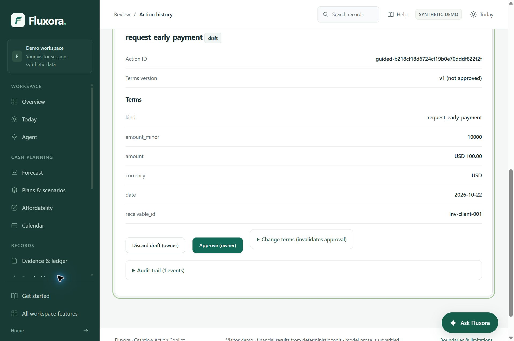
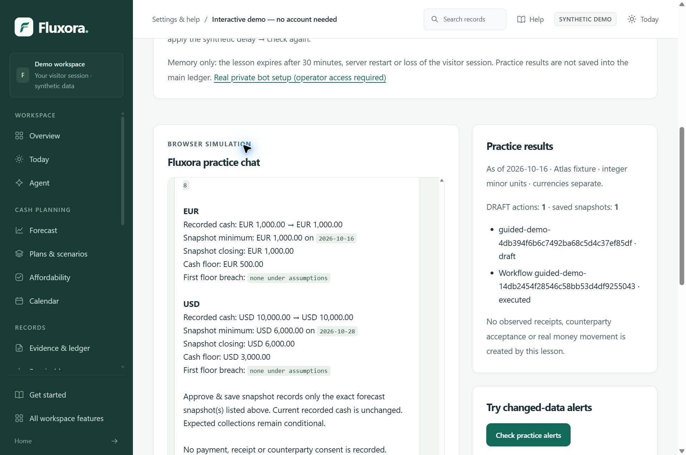

# Tested judge journey and live-model evidence

Application source **0.26.4**, tested 20 October 2026 at application commit
`6ef6f60de561a69981ae70b856c8b2ef390b5927`.
The later documentation/package commit changes no financial or model runtime.

Start at [product Home](https://fluxora.sklab.cc/), choose **Open workspace**,
then follow Forecast → scenario → Agent → DRAFT → separate owner review →
[Telegram browser practice](https://fluxora.sklab.cc/telegram/demo).
The full directory remains available from **All workspace features**.

## What was actually observed

| Step | Actual result | Boundary |
| --- | --- | --- |
| Home → Open workspace | Product Home at `/`; Business Overview at `/app` | Home is different from the active ledger |
| Forecast | Atlas recorded USD 10,000 / EUR 1,000; conditional minima USD 6,000 / EUR 1,000 | Currencies separate; expected collections conditional |
| Seven-day invoice delay | USD minimum -500, first breach 25 October, worst shortfall USD 3,500; EUR unchanged | Honest no-feasible-cash-floor outcome; preview changes no saved fact |
| Live Agent forecast | Correct read-only task; results matched the local forecast | Model interpreted the question; deterministic code calculated money |
| Live Agent preparation | One early-payment DRAFT, invoice `inv-client-001`, USD 100, requested 22 October | No approval, send, consent or payment |
| Saved-result reload | Same DRAFT, version 1, not approved; one action remained | Reload is historical display, not a provider retry |
| Separate owner step | A different save-forecast workflow remained pending until its checkbox/button was used, then executed | Saved a snapshot only; did not approve the DRAFT |
| Telegram practice | One practice DRAFT and one separately approved practice snapshot | Simulated delivery, no live AI, no private bot access |
| Settings & help | Desktop disclosure and mobile Documentation link opened | Hosted private connection settings remain locked |



The agent operated these browser controls in an existing synthetic Chrome visitor,
initially showing zero DRAFTs and pending workflows. One unapproved DRAFT and one
forecast snapshot were deliberately left in that expiring visitor workspace. This is
not an independent human study. No operator pairing or real-business ledger was changed.

## Fresh actual live-provider checks

Both submissions used server-side OpenRouter **`qwen/qwen3.7-flash`** configuration.
Credentials were not entered into the browser or copied into evidence. Each returned
a live task interpretation followed by local deterministic execution. Neither showed
429 or timeout. This is two-case compatibility evidence, not a universal accuracy or
availability guarantee; even valid structured parameters can misunderstand intent.

| Synthetic question | Provider-reported prompt / completion / total tokens |
| --- | --- |
| Baseline cash forecast for every currency, read only | 6,637 / 173 / 6,810 |
| Exact USD 100 DRAFT for the invoice/date above, no approval/send | 6,696 / 510 / 7,206 |

Total reported usage: **14,016 tokens**. Dollar cost was not measured. Financial
results were not sent back to a model. Direct reports and snapshot preparation used
no model. The app's saved result exposed selected terms and source-linked tool results.

## Local stubs, mocks and public simulation

The later local selection passed **109 tests in 40.45 seconds**, exit 0:

```sh
python -X utf8 -m pytest -q tests/test_model_adapter.py tests/test_takeover_regressions.py tests/test_direct_tasks.py tests/test_guided_tasks.py tests/test_telegram_demo.py --basetemp SHORT_WRITABLE_TEST_DIRECTORY
```

Replace the final placeholder with a short writable path. Tests need a development
environment installed with `.[test]`; the no-pip app environment does not contain pytest.

- **Local provider HTTP stubs:** dummy-credential 401 redaction, verification/reload and
  configuration invalidation, bounded deadline/retry exhaustion and malformed/oversized replies.
- **Fake/mock and deterministic tests:** late-result rejection before tools, DRAFT/pending
  authority, missing facts, invalid parameters, stale input, replay and simulated decisions.
- **Fresh public HTTPS visitor:** an independent memory-only cookie jar checked Telegram
  practice preparation, separate snapshot approval, accepted-button replay and rejected
  extra DRAFT creation. The main audit export was unchanged before/after practice,
  excluding export time and provider-status fields. Zero provider and real Telegram API calls.
- **Actual live provider:** the two browser translations above, kept separate from these tests.

Machine-readable [results](evidence/judge-live-results.json), the
[local test log](evidence/judge-regressions.txt), and
[HTTPS practice result](evidence/telegram-http.json) preserve the measured outcome.

The earlier full application suite passed **2,219 tests in 429.90 seconds**. It was not
re-run as another full local suite during this smoke check. The exact tested application
commit's [Windows/Linux CI](https://github.com/ShahadatTest/fluxora/actions/runs/39415968720)
completed successfully. Current workflow status is shown by the repository badge.

## Rendered layouts and scope

Eight surfaces at **360, 390 and 1280 CSS pixels** produced 24 checks. All had document
scroll width equal to client width. Surfaces: Home, Overview, Forecast, scenario form,
Agent composer, saved live DRAFT result, executed owner-review detail and Telegram
practice. Representative screenshots and scrolled DRAFT terms were visually inspected.
Narrow tab bars/tables retain their own scrolling. Chrome's native DPR was 1.5;
these are viewport-emulation checks, not physical-device or assistive-technology tests.



No new real Telegram delivery/callback test or server restart occurred in this pass.
Earlier delivery acknowledgments and disposable-canary restart evidence remain historical
in [validation](VALIDATION.md). The owner's reported fresh-user walkthrough lacks detailed
participant/task/timing records. No broader language benchmark, security certification,
all-operation usability audit or production money-movement readiness is claimed.
Final slides/video remain deferred. See [submission status](SUBMISSION-CHECKLIST.md).
