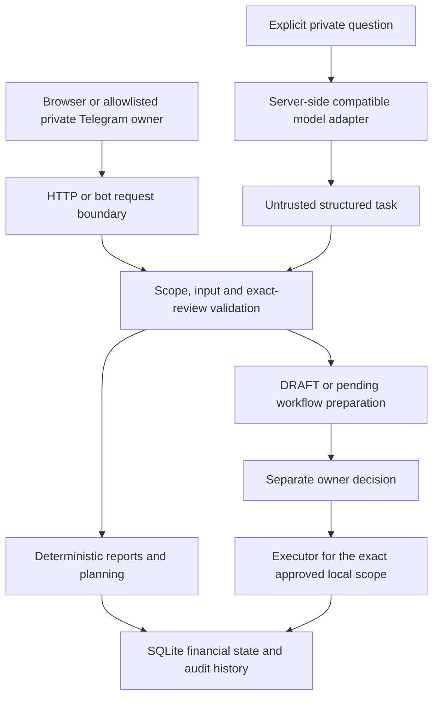

# Fluxora: technical documentation

Cashflow Action Copilot. Complete local source 0.26.4. Updated 20 October 2026.

## Purpose and contribution

Fluxora supports an SME owner's cash timing decisions using synthetic records. It connects deterministic forecasting and bounded plan comparison with evidence-linked preparation of work for owner review. Its specific contribution is the connection between analysis, explicit source facts and constrained action preparation. This document makes no claim of global uniqueness, competition eligibility, selection, certification or readiness for real-business money movement.

The project targets Topic E, SME Finance Copilot. The current demonstrator concentrates on cash-flow management, risk alerts, recorded funding positions and financial analysis. It has no lender marketplace, underwriting integration or independently validated financing recommendation service. The account-free public demo can use an operator-enabled model for guided task interpretation, with inline provider/data disclosure, one-submit report or DRAFT/pending preparation and optional exact review. Direct tools remain available without a model.

## Runtime and deployment modes

| Mode | Data and access | Model and Telegram boundary |
| --- | --- | --- |
| Private local launcher | Python 3.10+, SQLite and loopback HTTP. A trusted owner keeps a persistent database. No production login. | Optional local Web connection profiles. Credentials stay in memory by default. Windows Remember uses a separate OS-account DPAPI vault. A bot requires explicit configuration and start. |
| Hosted public demo | HTTPS and a separate expiring synthetic workspace for each browser cookie. Records live on the server. | Visitor guided requests can use a privately configured provider only with the explicit public-AI operator flag, qualification, disclosure and bounded allowances. API/Telegram settings are a disabled static preview. Browser Telegram practice is simulated. |
| Optional private companion | One allowlisted Telegram account explicitly pairs one workspace. Pairing does not extend the workspace lifetime. | Opt-in real bot delivery about synthetic data. A separately enabled model requires the existing verification and qualification process. |

At the latest application review, the deployed UI used minimal hosted release `0.24.4-8c53b6d99858`; complete downloadable local source is `0.26.4`, including private local settings and setup helpers. The two version labels identify packaging branches, not different claims of financial accuracy. Product Home is `/`; Business Overview is `/app`; `/welcome` remains a product-page alias. [The latest walkthrough](JUDGE-WALKTHROUGH-2026-10-20.md) records the tested hosted behavior. Documentation/package publication does not itself deploy a new hosted release.

## Autopilot worker

`autopilot.py` keeps owner policies, bounded queued jobs, leased claims and notification metadata in `autopilot-control.sqlite`, separate from credentials. Financial effects and `autopilot_runs` result journal commit together in the selected ledger database. The worker then completes the scheduling index; a crash between commits recovers the saved journal without re-running effects. A persistent job-attempt table preserves the rolling allowance across history pruning/restart. A progress chain distinguishes A→B→A financial-input transitions without looping on its own actions/workflows.

Scheduled analysis reuses forecast, missing-fact and adaptive planning tools. Only a selected sufficient strategy within all per-currency caps can create a complete DRAFT batch; snapshots remain pending owner approval. No LLM call is needed. Existing role/domain boundaries remain the final authority. A validated private Telegram task can use the optional configured model for one interpretation while Autopilot is on; the remaining deadline carries through local preparation.

The hosted and persistent local entrypoints start the worker. Policies default off. Enabled saved policies explicitly resume on restart while the app runs. Telegram polling/start and model qualification remain separate. Public visitor expiry is preserved and expired policies/job summaries are pruned. See [Autopilot](AUTOPILOT.md).

## Architecture



The standard-library HTTP server and SQLite store preserve the existing architecture. Main modules:

- `forecast.py`, `planning.py`, `treasury.py`: financial projection and allowed strategy comparison.
- `ledger.py`, `store.py`, `settlement.py`: recorded state, transactional persistence and settlement semantics.
- `authz.py`, `actions.py`, `agent_workflows.py`: business scope, action lifecycle and explicit owner decisions.
- `agent.py`, `agent_tasks.py`, `model_adapter.py`, `task_qualification.py`: bounded tools, structured interpretation, provider transport and finite qualification.
- `agent_skills.py`, bundled skill files: six reviewed guidance scopes. Uploaded documents cannot install skills.
- `web.py`, `site_web.py`, `ui.py`, `workspace_ui.py`: routes, public product/documentation pages and the multipage app shell.
- `telegram_api.py`, `telegram_bridge.py`, browser practice implementation: separate real transport and simulated lesson boundaries.

Eight outer read/proposal tools expose existing deterministic capabilities. The workflow catalog contains 55 named supported local operation types, and the bundled guidance catalog contains six skills. These counts do not mean that a model has 55 autonomous permissions or that every operation has been tested through unrestricted live language.

## Financial model

Money uses integer minor units. Decimal user inputs remain strings until currency-aware validation converts them exactly. Each currency has its own balances, constraints and projection. Display FX does not provide cash or execute a conversion.

For each date in the selected horizon, the engine builds the applicable collection and obligation schedules. Unknown same-day ordering uses outflows before inflows to calculate the conservative intraday low. A closing balance and an intraday low therefore answer different questions. Floor checks use the intraday low. Expected collections remain conditional, restrictions affect availability, and missing evidence is not treated as a confirmed zero or payment.

Scenarios calculate hypothetical changes without rewriting observations. Planning examines a bounded set of permitted strategies. Protection and consent rules can reject a candidate. A financially sufficient proposal still requires its separate decisions and facts. When no candidate meets the allowed constraints, the product reports no feasible plan.

### Reproducible synthetic example

Atlas fixture as of 16 October 2026, 30-day horizon:

| Quantity | Engine result |
| --- | --- |
| Recorded USD cash | USD 10,000.00 |
| Recorded EUR cash | EUR 1,000.00, separate |
| USD cash floor | USD 3,000.00 |
| Baseline minimum intraday balance | USD 6,000.00 |
| Minimum with `inv-client-001` delayed seven days | USD -500.00 |
| Worst USD shortfall in that scenario | USD 3,500.00 |

The deck's editable chart uses these exact daily engine outputs. It displays USD minor units divided by 100 and preserves the original dates. These figures do not describe a real company or a visitor who has changed their workspace. Input data and software defects can still produce wrong results.

## Model and task execution

A direct report needs no model. In the private guided flow, the owner sees the intended outbound question and task catalog. The model selects a supported task, supplies structured parameters, requests clarification or declines. Local code treats that response as untrusted and checks schema, scope, literal supplied details and permitted capabilities. Send immediately executes only the validated read/DRAFT path under a shared deadline and displays its exact selection in the result. Options → Preview before sending instead requires exact interpretation confirmation before execution. Final owner approval stays separate. See [one-submit tasks](DIRECT-TASKS.md).

Financial results come from successful deterministic tools and server-authored rendering. The guided model does not receive those results for a final rewrite. Optional prose in the advanced mode remains explicitly unverified. A schema-valid interpretation may still misunderstand the user. Qualification and finite language guards do not establish semantic correctness for arbitrary questions.

The model can read and prepare DRAFT/pending work. It has no self-approval, real payment, permission-changing or counterparty-send tool. The owner reviews an immutable local workflow. A server executor applies only that approved scope, subject to existing domain rules and additional observation/acceptance confirmations. Payroll protection remains active. Uploaded documents supply evidence, never authorization.

## Lifecycle and reliability

Proposed plan, DRAFT, owner approval, counterparty acceptance, observed payment and reconciliation remain distinct. Owner approval does not prove external acceptance or payment. An explicitly simulated send does not contact a business counterparty. A recorded source reference does not authenticate the source.

Durable request identities, transactional saves and saved result links prevent accepted replay from creating another effect. Exact review tokens bind scope and revision. Stale reviews require fresh inspection. Startup does not silently continue an interrupted model run. Provider status restarts unverified and changes when configuration changes.

The adapter bounds request time, retries and response bytes. The runner checks the remaining deadline again before tools and rejects late results. Error handling discards arbitrary provider error bodies before display and persistence. Dummy-credential regressions cover answer text and SQLite history. Remote providers may continue work or bill after a local timeout. OS resolver behavior, other processes and provider-wide quotas remain external limits.

## Telegram and judge access

`/telegram/demo` creates a separate disposable Atlas lesson with supported commands and the real deterministic tools. Delivery and language interpretation are simulated. Its DRAFT confirmation creates only a practice DRAFT. Its later owner approval saves a separate forecast snapshot. Practice data never enters the main visitor workspace or real private bot.

The private companion uses the allowlist and one-time pairing flow. Notifications are opt-in. Exact buttons refer to their reviewed request and current link. Unknown delivery outcomes are not automatically resent. Use a separate bot for a local installation if the VPS bot already polls; a second poller can consume updates intended for the first.

## Setup and test commands

Clone or extract this repository and enter its root directory. On Windows, double-click `START_FLUXORA.cmd`. The helper creates a standard-library venv without pip downloads and opens the local website. Default local database: `.runtime/local/state.sqlite`. Stop with Ctrl+C and restart with the same path to retain records.

```powershell
# Windows readiness check, without model or bot calls
.\tools\setup_local.ps1 -Python python -CheckOnly

# macOS/Linux readiness and startup
python3 -m tools.local_setup --check
python3 -m tools.local_setup --start --open-browser
```

Optional environment configuration uses `CASHFLOW_MODEL_API_KEY`, `CASHFLOW_MODEL_BASE_URL` and `CASHFLOW_MODEL_NAME`. Enter secrets only in private local settings or the starting process environment. Test dependencies are separate from runtime:

```powershell
python -m venv .venv
.\.venv\Scripts\python.exe -m pip install -e ".[test]"
.\.venv\Scripts\python.exe -m pytest -q
```

The evidence distinguishes automated local/stub tests, scripted mock providers and fresh live checks. See [validation](VALIDATION.md). Focused Settings navigation checks passed at desktop, 360px and 390px; a complete current visual/device/accessibility review and independent fresh-user walkthrough remain pending. No demo recording is included.

## Operations and limitations

The local launcher binds to loopback. Hosted publication requires deliberate operator configuration. The current demo runs non-root with a read-only container root behind the existing HTTPS proxy. It has no host port bindings. The public slot limit is 256 unexpired workspaces and aggregate visitor storage is bounded at 256 MiB, with 24-hour expiry. This is finite anonymous session separation, not production identity or abuse-resistant admission.

Keep financial databases, backups, local credential vaults and virtual environments outside source packages. Restore in an isolated test before relying on a backup. The hosted release has a private server-side backup and rollback path; no production data or credentials are included here. Real-business use would require further identity, operations, independent security and financial/source validation.


Public guided AI in 0.25.11 is an explicit operator option. See [public AI controls](PUBLIC-AI.md) for the durable daily attempt counter, zero retries, qualification, data disclosure and endpoint restrictions. The model still cannot approve work, invent source events or move money. Private Telegram model use has a separate scope from the public allowance.
