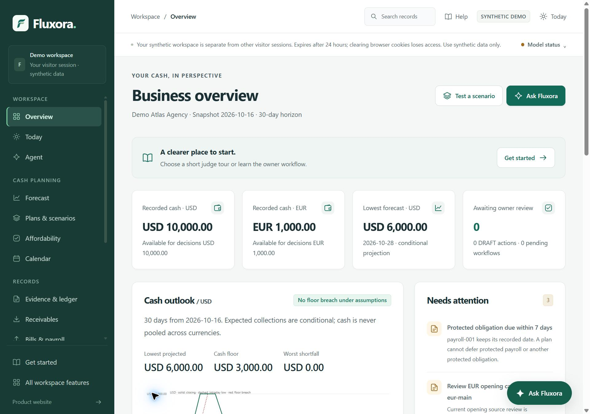
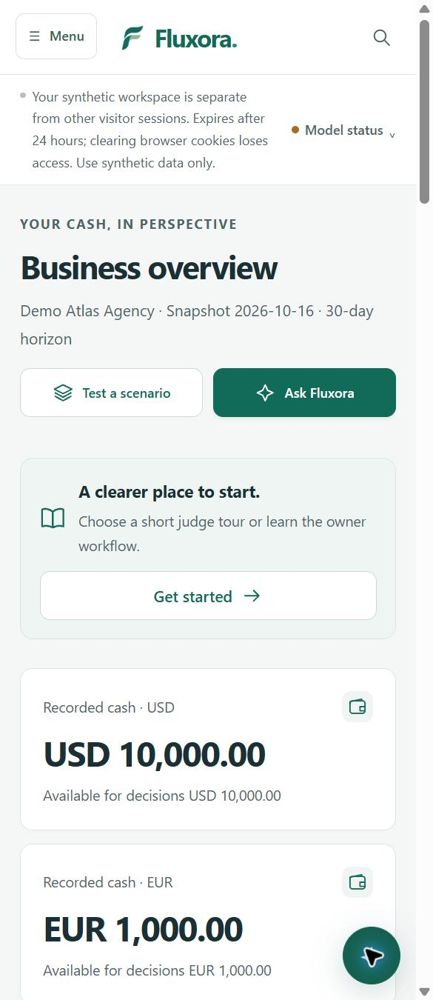
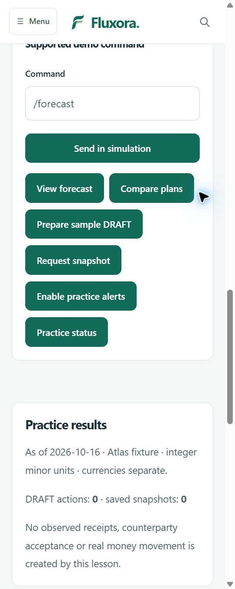

# Rendered responsive review

20 October 2026 · application source **0.26.3**. Browser access became available during this review. This supersedes earlier reports that rendered inspection was blocked; it does not relabel their historical test results.

## Findings and corrections

1. **Overview amounts clipped at medium desktop widths.** At 1280px, four cards displayed internal horizontal scrollbars and cut off the full amounts. Financial values now use their card's available width, with wrapping for longer values. Product-preview amounts also wrap instead of scrolling internally. No rounding or financial calculation changed.
2. **Mobile guide launcher covered too much content.** Below 600px it now uses a 52px button, with an explicit accessible name. The desktop label and existing native dialog, close control and Escape behavior remain available.
3. **Practice commands returned to the page top.** Successful Telegram-practice submissions now return to `#practice-chat`, with space below the sticky header. The conversation still scrolls to its newest reply.
4. **Practice shortcuts had large wrapper margins.** The surrounding generic form decoration added 15px vertical margins to each shortcut. A scoped rule removes those margins while keeping the existing forms, review controls and CSRF handling.



## Browser scope

Actual Chrome browser rendering was inspected at **360×900**, **390×900** and **1280×900 CSS pixels**, using the machine's native 1.5 device-pixel ratio. Screenshots are consequently larger in physical pixels. Temporary viewport overrides were used for emulation.

The initial visible viewport of these ten deployed pages was captured and inspected at all three widths:

| Page | Route |
| --- | --- |
| Welcome | `/welcome` |
| Overview | `/app` |
| Guided agent | `/agent/tasks` |
| Forecast | `/forecast` |
| Evidence and ledger | `/ledger` |
| Plan comparison | `/plans` |
| Autopilot | `/autopilot` |
| Telegram practice | `/telegram/demo` |
| Locked connection preview | `/settings/connections` |
| Security documentation | `/docs/security` |

Across these **30 views**, document scroll width did not exceed client width, and inspected Overview/product-preview amounts did not overflow their own containers. Wide financial tables and local navigation retain explicit horizontal scrolling; this result does not assert that every table fits without scrolling.

The main matrix was captured on hosted release `0.24.2-a9d814693cc2`. The final change only removes Telegram-shortcut wrapper margins. Its release, `0.24.3-8c2f9feb5722`, was independently rechecked on the Telegram page at all three widths and in a focused scrolled mobile view. Other matrix screenshots retain their original attribution.

Additional actual UI interactions:

- Opened the mobile navigation and expanded Settings & help; followed its API & Telegram link to the locked hosted connection page.
- Opened the mobile floating guide, inspected the dialog, closed it with Escape and observed focus returning to its launcher. No guide question was transmitted to a model.
- Opened a direct deterministic forecast from Agent, without a provider call.
- Submitted a practice forecast and observed `#practice-chat`, readable chat positioning below the header and the computed reply. Delivery was simulated.
- Scrolled down over the conversation at its lower boundary; page scroll advanced from 1258 to 2158, reaching the controls below it.
- Used Tab to reach the practice-alert control and inspected the final compact command shortcuts. No real alert or Telegram delivery was requested.

The initial image-readiness measurement included deferred `loading="lazy"` artwork. That count is labelled **unready images at capture start**, not failed resources. A focused DOM check confirmed the welcome page's off-screen artwork was lazy and pending. It was not counted as a broken image.





## Automated and deployed checks

The final affected selection passed **62 tests in 23.64s**:

```text
../../../work/venv/Scripts/python.exe -X utf8 -m pytest -q tests/test_design_refinement.py tests/test_workspace_ui.py tests/test_telegram_demo.py tests/test_floating_assistant.py tests/test_floating_assistant_local.py --basetemp C:/Users/shaha/Documents/Codex/t269final -o cache_dir=../../../work/visual269/cache
```

The command ran from the clean source checkout with `PYTHONDONTWRITEBYTECODE=1`. These are synthetic tests, local HTTP/SQLite and client DOM doubles. They are separate from actual browser rendering and real provider evaluation.

A fresh disposable VPS canary exercised the actual scheduled worker. It prepared two DRAFTs and one pending snapshot; separate **synthetic owner** decisions saved the snapshot, approved one DRAFT and cancelled the other. Measured scheduled completion was **3.644s**. Cash and observed payments were unchanged. An actual container restart retained the enabled policy, action identities/states and saved snapshot, with no duplicate DRAFTs. Foreign job access remained blocked.

The canary used simulated Telegram transport: **zero real Telegram API calls and zero provider calls**. No live-language accuracy evaluation was repeated for this UI correction. Existing finite model qualification was checked against the unchanged model contract, not regenerated through fictitious calls. Restart begins connection verification unverified until an actual successful request, as intended.

Final Fluxora deployment passed health and source-manifest checks. Runtime environment, private Telegram configuration, base ledger, shared provider budget and proxy were preserved. Unrelated containers were unchanged, and seven existing domain canaries returned 200. The stopped-state backup and rollback remain available to the operator. No competition entry was submitted.

For context only, predecessor source **0.26.2** had a complete local result of **2,213 passed in 423.03s** and successful Windows/Linux [Actions run 39403116156](https://github.com/ShahadatTest/fluxora/actions/runs/39403116156). That result is not a relabelled full-suite run for 0.26.3. Consult the current [Actions workflow](https://github.com/ShahadatTest/fluxora/actions/workflows/tests.yml) for the publication's cross-platform status.

## Limits

This is a focused rendered review of principal pages and selected scrolled/interactive states, not an exhaustive inspection of every route, control, data volume or business operation. Chrome viewport emulation does not prove physical-device touch behavior, Safari/Firefox rendering, screen-reader accessibility or real-network performance. No independent human study was performed by the agent. The owner's earlier report of a fresh-person walkthrough remains user-reported feedback without a supplied task/device/timing log.

No model, financial calculation, approval, consent, payment or reconciliation rule changed. Slide and video work remain deferred at the user's request. Screenshots contain synthetic data and no credentials.
